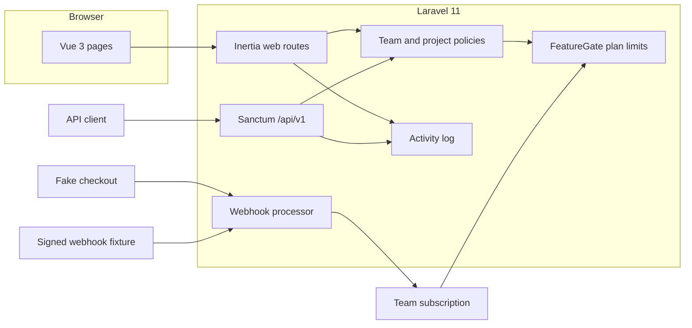

# Keel

Keel is a multi-tenant SaaS starter for a small team workspace. It is a portfolio demo by Arpan Bom: Laravel 11, Vue 3, Inertia, Vite, and Tailwind. One team is the tenant. Projects, invitations, subscriptions, and the activity log are scoped to that team.

Roles are `owner`, `admin`, and `member`, enforced with Laravel policies.

- **Owner** updates the team, deletes it, invites people, changes roles, removes admins and members, and manages billing.
- **Admin** updates the team, invites people, and removes members. An admin cannot remove the owner, delete the team, or change the plan.
- **Member** works on projects inside the team.

Plans are Starter, Pro, and Business. Starter allows 3 members and 3 projects. Pro allows 10 members and 25 projects. Business has no member or project cap in this demo. Pending invitations reserve a member seat. Crossing a cap returns an error instead of writing the row.

Billing implements a `BillingGateway` interface. The only driver is `fake`. Checkout is an in-app confirmation page, and `POST /webhooks/billing` accepts a Stripe-style signed body (`t={unix},v1={hmac}` over `{timestamp}.{raw_body}`). The signing secret in `.env.example` is a local demo value, not a live credential. Webhook fixtures live in `tests/Fixtures/billing`.

The JSON API is Sanctum. A personal access token is created for the current team and carries a `team:{id}` ability. `/api/v1/projects` and `/api/v1/team` only see that team.

Invitations are links on the team page. This demo does not send email.

## Architecture



## Run it locally

Requirements: PHP 8.2+, Composer, Node 20+, and the SQLite extension.

```bash
composer install
cp .env.example .env
php artisan key:generate
touch database/database.sqlite
php artisan migrate --seed
npm ci
npm run build
php artisan serve
```

For frontend hot reload, use `composer run dev` instead of `php artisan serve` after the first `npm ci`.

Seeded local accounts, both with password `password`:

| Email | Role on Northwind Studio |
| --- | --- |
| demo@example.com | Owner |
| member@example.com | Member |

`BILLING_GATEWAY=fake` and `BILLING_WEBHOOK_SECRET=whsec_local_demo` are defaults. There is no Stripe secret key to add.

## Test it

PHP feature tests use Pest and SQLite in memory:

```bash
php artisan test
```

Two Vue components, `RoleBadge` and `PlanLimitMeter`, are covered by Vitest:

```bash
npm test
```

The production asset build is:

```bash
npm run build
```

GitHub Actions (`.github/workflows/ci.yml`) runs `composer install`, `php artisan test`, `npm ci`, and `npm run build`.

## Portfolio demo

This repository is a portfolio piece for Arpan Bom's CV. It is not a hosted product and it is not a production billing integration.

- The gateway never contacts Stripe and never charges a card.
- Invitations are not emailed.
- Request volume, latency, and error rate are not measured. Placeholder: not measured.

Composer is configured with `policy.advisories.block` set to false so Laravel 11.57 can be installed. Packagist ranges written as `<12.x` also match the 11.x line, and at least one email-validation advisory is recorded against every 11.x release. Pinning 11.57 is intentional for this starter. It is not a claim that every advisory is irrelevant.

## License

MIT. See [LICENSE](LICENSE).
